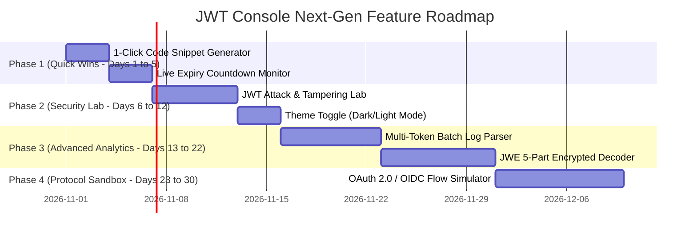

# 🚀 JWT Console — Advanced Feature Proposals & Technical Roadmap

An actionable, enterprise-grade engineering specification document outlining high-impact features to expand **JWT Console** into an industry-leading **Identity & Cryptographic Security Platform**.

---

## 📋 Executive Summary

JWT Console currently offers:
- ✅ Client-side and backend timing-safe JWT decoding
- ✅ 9 Cryptographic signature algorithms (HS256..512, RS256..512, ES256..512)
- ✅ Automated security audit scanning & dictionary cracking worker
- ✅ Remote JWKS auto-discovery with SSRF loopback shielding
- ✅ Side-by-side claim difference comparison engine
- ✅ Offline token generator with real-time signing
- ✅ Forensic PDF export via ReportLab
- ✅ Interactive 3D Three.js cryptographic ambient visualization & scroll reveal

To evolve this platform into an **all-in-one developer security suite**, this document specifies **7 next-generation features** complete with user stories, technical architecture, API schemas, UI design wireframes, and implementation steps.

---

## 🎯 Proposed Features Matrix

| # | Feature Name | Category | Complexity | Impact | Target Persona |
|---|--------------|----------|------------|--------|----------------|
| **1** | **Live Expiry & Session Lifecycle Monitor** | UX / Real-Time | Low | 🟢 High | Frontend & API Devs |
| **2** | **1-Click Developer Code & Request Snippets** | Productivity | Low | 🟢 High | Full-Stack Engineers |
| **3** | **Interactive JWT Attack & Tampering Lab** | Security / Pen-Testing | Medium | 🟣 Critical | Security Auditors & QA |
| **4** | **Multi-Token Batch & Server Log Parser** | DevOps / Audit | Medium | 🟢 High | SecOps & Site Reliability |
| **5** | **JWE (JSON Web Encryption — RFC 7516)** | Cryptography | High | 🟣 Critical | Enterprise & FinTech Devs |
| **6** | **OAuth 2.0 & OIDC Flow Debugger** | Protocol | High | 🟢 High | Identity Engineers |
| **7** | **Dual Cyber Dark / Crisp Light Mode Toggle** | Design / Accessibility | Low | 🟡 Medium | All Developers |

---

## 📑 Detailed Feature Specifications

---

### 1. ⏱️ Live Expiry & Session Lifecycle Countdown Monitor

#### 📌 Overview
A real-time temporal lifecycle widget that visually displays token lifetime progress, remaining time countdown clock, clock skew margin, and triggers optional desktop notifications upon expiration.

#### 💡 Key Capabilities
1. **Interactive Lifetime Progress Bar:** Visual bar illustrating `% time elapsed` vs `% time remaining` based on `iat` and `exp`.
2. **Dynamic Ticking Clock:** Real-time countdown updating every second (e.g. `00h 14m 32s remaining`).
3. **Temporal Status Badges:**
   - 🟢 `Active`: Token currently valid within normal lifespan.
   - 🟡 `Expiring Soon`: Less than 5 minutes remaining.
   - 🔴 `Expired`: Token lifetime exceeded (`now >= exp`).
   - 🔵 `Not Yet Valid`: `nbf` (not-before) timestamp is in the future.
4. **Clock Skew Simulation:** Slider allowing developers to simulate client-server clock drift (±30s, ±120s, ±5min).
5. **Browser Alerts:** Optional Web Notification API alert or subtle audio chime when the inspected token expires during local testing.

#### 🏗️ Component Architecture
- **Component File:** `src/components/LifecycleMonitor.jsx`
- **State Integration:** Connected via `useJwtContext()` reading `result.payload.exp`, `iat`, `nbf`.
- **Hooks:** Custom `useInterval()` ticker updating remaining seconds every 1,000ms.

#### 🖥️ UI Wireframe Concept
```
┌────────────────────────────────────────────────────────────────────────┐
│ ⏱️ TOKEN LIFECYCLE MONITOR                         [● ACTIVE · 14m 32s] │
├────────────────────────────────────────────────────────────────────────┤
│ Issued: 10:00:00 AM (UTC) ────────── NOW ────────── Expiry: 10:15:00 AM│
│ [██████████████████████████████████░░░░░░░░░░░░░░] 74% elapsed (60s skew)│
│                                                                        │
│ ⏳ Time Remaining: 00h 03m 48s    [🔔 Alert on Expiry: ON]             │
└────────────────────────────────────────────────────────────────────────┘
```

---

### 2. 🚀 1-Click Developer Request & SDK Snippet Generator

#### 📌 Overview
Transforms any inspected or generated JWT token into production-ready API request boilerplate and SDK integration code across 5+ languages with a single click.

#### 💡 Supported Code Formats
1. **cURL:**
   ```bash
   curl -X GET https://api.yourdomain.com/v1/user \
     -H "Authorization: Bearer <TOKEN>" \
     -H "Accept: application/json"
   ```
2. **Postman / Insomnia:**
   One-click copy format for Postman Collection Variables:
   ```json
   {
     "key": "jwt_token",
     "value": "<TOKEN>",
     "type": "string"
   }
   ```
3. **JavaScript / TypeScript (Fetch & Axios):**
   ```typescript
   import axios from 'axios';

   const response = await axios.get('https://api.yourdomain.com/v1/user', {
     headers: { Authorization: `Bearer ${token}` }
   });
   ```
4. **Python (Requests & HTTPX):**
   ```python
   import httpx

   headers = {"Authorization": f"Bearer {token}"}
   res = httpx.get("https://api.yourdomain.com/v1/user", headers=headers)
   ```
5. **Go (`net/http`):**
   ```go
   req, _ := http.NewRequest("GET", "https://api.yourdomain.com/v1/user", nil)
   req.Header.Set("Authorization", "Bearer " + token)
   ```

#### 🏗️ Component Architecture
- **Component File:** `src/components/SnippetGeneratorModal.jsx` or inline in `DecoderPanel.jsx`.
- **Features:** Language tab switching, syntax highlighting, instant clipboard copy with toast feedback.

---

### 3. 🧪 Interactive JWT Attack & Tampering Playground (Pen-Testing Lab)

#### 📌 Overview
A dedicated security sandbox allowing backend engineers and penetration testers to simulate real-world JWT exploit mutations and test whether their backend endpoints safely reject forged tokens.

#### 💡 Attack Mutation Presets
1. **The `alg: none` Exploit:** Strips the cryptographic signature and rewrites the header to `{"alg": "none"}`.
2. **Algorithm Confusion (HMAC ⇄ RSA):** Signs a token expecting RS256 with HS256 using the public RSA certificate string as the HMAC shared key.
3. **Privilege Escalation:** Interactive field replacer allowing instant modification of claims (e.g. changing `"role": "user"` to `"role": "admin"`, or adding `"scope": ["admin:all"]`).
4. **Time Travel (Indefinite Expiration):** Extends `exp` 10 years into the future to test whether the server verifies expiration limits.
5. **Null Byte / Header Injection:** Injects null characters or fake `jku`/`kid` headers to test parser robustness.

#### 🌐 "Test Against My API" Feature
- Developer enters their local or staging API endpoint: `http://localhost:3000/api/protected`
- Clicks **"Dispatch Exploit Request"**.
- Displays HTTP status code and response body:
  - 🟢 **SECURE:** Server returned `401 Unauthorized` (Attack rejected).
  - 🔴 **VULNERABLE:** Server returned `200 OK` (Vulnerability detected!).

---

### 4. 📂 Multi-Token Batch & Log File Parser (HAR / Server Logs)

#### 📌 Overview
Enables DevOps, SecOps, and QA engineers to upload server access logs, HTTP Archives (HAR files), or raw dumps to extract, audit, and validate dozens or hundreds of JWT tokens at once.

#### 💡 Key Capabilities
1. **Multi-Format Ingestion:** Drag-and-drop support for `.log`, `.txt`, `.har`, `.csv`, and `.json`.
2. **Regex JWT Extractor:** High-speed regex parsing isolating all Bearer token instances:
   `eyJ[A-Za-z0-9-_]+\.eyJ[A-Za-z0-9-_]+\.[A-Za-z0-9-_]+`
3. **Batch Audit Dashboard Table:**
   - Columns: Token Subject, Issuer, Algorithm, Expiry Date, Signature Status, Security Health.
   - Status Filters: `Show Expired`, `Show Insecure (alg:none / weak)`, `Show Valid`.
4. **Consolidated Report Export:** Export the complete batch audit as CSV, JSON, or an executive PDF summary.

---

### 5. 🔏 JWE (JSON Web Encryption — RFC 7516) 5-Part Decoder

#### 📌 Overview
While standard JWTs use JWS (JSON Web Signatures: 3 dot-separated segments), sensitive banking, healthcare, and OIDC implementations use **JWE (JSON Web Encryption: 5 dot-separated segments)** for confidentiality.

#### 💡 Key Capabilities
1. **Automatic JWE Detection:** Identifies 5-part tokens (`header.encrypted_key.iv.ciphertext.tag`).
2. **Protected Header Inspector:** Decodes and visualizes JWE encryption metadata:
   - `alg`: Key management algorithm (e.g., `RSA-OAEP-256`, `ECDH-ES`, `A256KW`).
   - `enc`: Content encryption algorithm (e.g., `A256GCM`, `A128CBC-HS256`).
   - `zip`: Compression algorithm (e.g., `DEF`).
3. **Live Decryption Tool:**
   - Input Private RSA key (PEM) or AES shared key.
   - Decrypts the ciphertext in real-time and reveals the nested payload claims.

---

### 6. 🔐 OAuth 2.0 & OIDC Protocol Debugging Playground

#### 📌 Overview
An integrated protocol client enabling developers to simulate OAuth 2.0 and OpenID Connect flows against standard identity providers without needing third-party tools like Postman.

#### 💡 Supported Flows
1. **Authorization Code + PKCE:**
   - Generates high-entropy `code_verifier` and SHA-256 `code_challenge`.
   - Constructs the authorize URL for Auth0, Google, Okta, or Keycloak.
   - Handles the callback redirect code exchange for Access and ID Tokens.
2. **Client Credentials (M2M):**
   - Inputs Client ID, Secret, and Token Endpoint.
   - Dispatches machine-to-machine grant request and automatically feeds the resulting token into the Decoder view.
3. **Preset Providers:** Pre-configured configurations for Auth0, Google Identity, GitHub, AWS Cognito, Okta, and Keycloak.

---

### 7. 🌗 Dual Theme Support (Cyber Dark Mode ⇄ Crisp Light Mode)

#### 📌 Overview
A fluid theme engine toggle allowing developers working in low-light environments to switch between the crisp white light mode and an obsidian cyber-dark aesthetic.

#### 💡 Styling Tokens
- **Dark Mode Background:** Deep obsidian `#090d16` with dark slate card surfaces `#0f172a`.
- **Dark Mode Accents:** Neon purple `#a855f7`, electric cyan `#06b6d4`, and glowing border highlights.
- **Persistence:** Saved in `localStorage.getItem("jwt_theme")` with system preference auto-detection (`prefers-color-scheme`).

---

## 🛠️ Step-by-Step Implementation Roadmap



---

## 💡 Tech Stack & Libraries for Next Expansion

| Feature Area | Recommended Library / Tool | Purpose |
|--------------|----------------------------|---------|
| **JWE Decryption** | `jose` (browser-side) / `cryptography` (FastAPI) | High-speed RFC 7516 decryption |
| **Batch Parsing** | Browser Web Worker + `PapaParse` / Regex | Non-blocking log processing |
| **Code Snippets** | `prismjs` or custom Tailwind syntax highlighter | Crisp terminal-style formatting |
| **Sound / Notifications** | Web Audio API + HTML5 Notification API | Non-intrusive expiry chimes |
| **OAuth 2.0 PKCE** | `crypto.subtle.digest('SHA-256')` | Native browser cryptographic PKCE challenge generation |

---

*Document created for **JWT Console (JWT Security Suite)**.*
